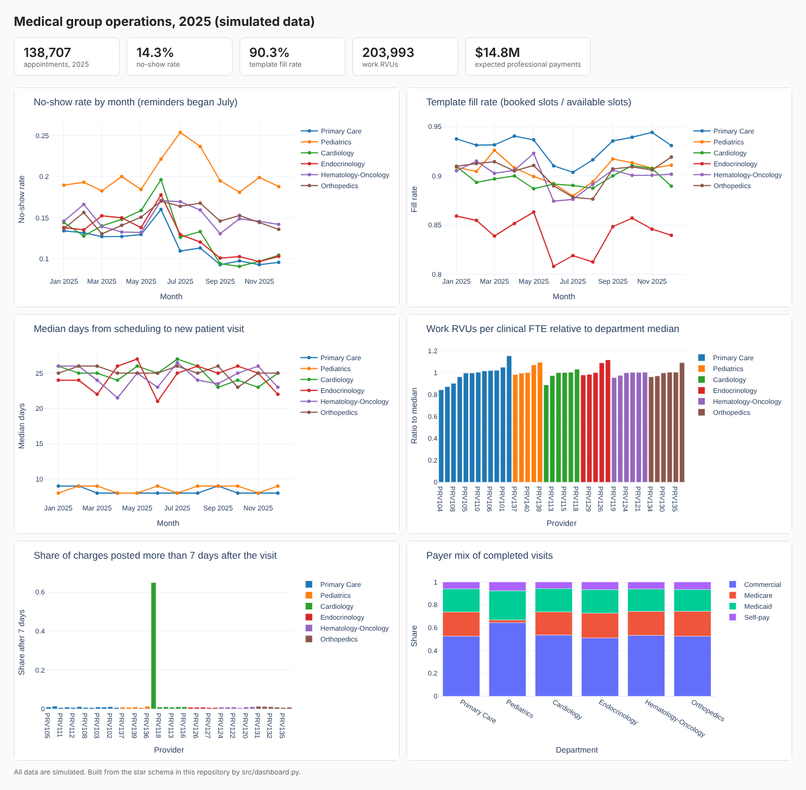
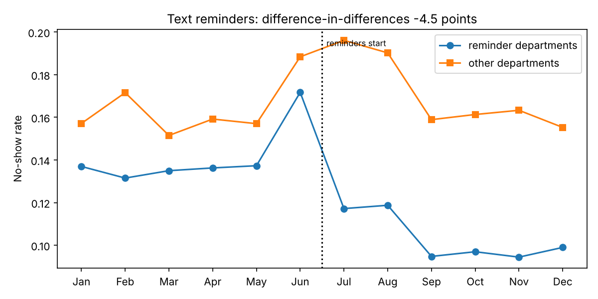
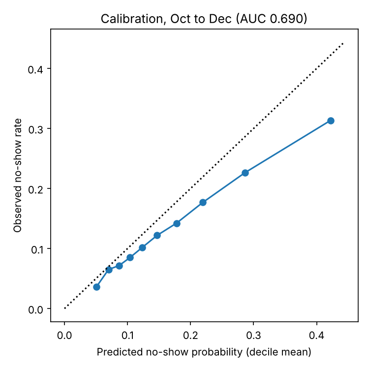
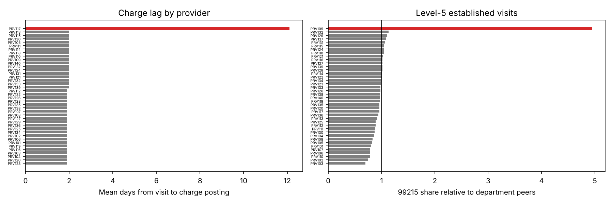

# Ambulatory clinic operations analytics

An analytics workflow for a medical group's ambulatory operations: a year of scheduling and billing extracts for six departments and 40 providers is cleaned and checked in SQL, modeled as a star schema ready for Power BI, and used to answer the questions operational, clinical, and finance leaders bring to an analyst. Did the text-reminder program reduce no-shows? Which appointments are likely to be missed? How full are provider templates and how long do new patients wait? Which providers need follow-up on charge lag or coding patterns?

All data are simulated (`src/simulate.py`); no real patients, providers, or organizations are represented. The tables mirror the structure of common ambulatory EHR reporting extracts: template slots, appointments with status, and professional charges with CPT codes and work RVUs. Several effects were planted so that every finding can be checked against the truth.



## Results in brief

| Question | Answer |
| --- | --- |
| Did text reminders reduce no-shows? | Yes. A difference-in-differences comparison with the departments that did not get reminders attributes a 4.5-point reduction to the program (log odds ratio −0.41, 95% CI −0.48 to −0.35); the true effect planted in the simulation, −0.45, lies inside the interval |
| Would a before-and-after comparison have been right? | No. It shows 3.8 points, because no-shows rose everywhere in the summer, which the comparison departments reveal |
| Can no-shows be predicted? | Moderately: an explainable logistic model reaches an AUC of 0.69 on the last three months, as good as gradient boosting (0.69), and the riskiest 10% of appointments contain 23% of no-shows, so targeted outreach reaches 2.3 times more no-shows than random calls |
| What drives no-show risk? | Prior no-shows (odds ratio 3.5 for three or more), Medicaid coverage (1.9) and self-pay (1.5) compared with commercial insurance, longer scheduling lead times (1.37 per unit of log days), first or last appointments of the day (1.29), younger age (0.90 per decade), and reminders (0.66) |
| Which providers need follow-up? | One cardiologist posts 65% of charges more than 7 days after the visit (others: about 1%), and one primary care physician bills 99215 for 35% of established visits against 7% for peers (p < 10⁻²⁵⁰), a pattern for a coding compliance review rather than a conclusion. Both were the planted cases, and no other provider was flagged |

## What is in it

1. Staging and data quality (`sql/01_staging.sql`, `src/build_warehouse.py`): typed loads of six source files and nine checks, including unique keys, every appointment tied to a template slot, no slot booked twice, no scheduling date after the visit, a charge for every completed visit and none for missed visits, no charges posted before the service date, and no adult patients in pediatrics. All pass (`results/tables/data_quality_checks.csv`).
2. Star schema (`sql/02_star_schema.sql`): `dim_date`, `dim_department`, `dim_provider`, `dim_patient` (de-identified to age band and payer), `fct_appointment`, `fct_slot`, and `fct_charge`, exported as Parquet for Power BI or Tableau. Window functions compute each patient's prior no-shows using only earlier dates, so the feature cannot leak the outcome. Columns, sources, and derivation rules are in [`docs/data_dictionary.md`](docs/data_dictionary.md).
3. Operational metrics (`sql/03_metrics.sql`): no-show and late cancellation rates, template fill rate, days to new patient visit, work RVUs per clinical FTE against the department median, charge lag, E/M level distribution, and payer mix.
4. Analyses (`src/analysis.py`): the reminder evaluation, the no-show model, and provider flags.
5. Outputs: an interactive dashboard (`dashboard/clinic_operations_dashboard.html`, self-contained, opens in any browser), a filterable Excel provider scorecard with monthly tabs (`results/provider_scorecard.xlsx`), and tables and figures in `results/`.

## The reminder program



Reminders began on July 1 in Primary Care, Cardiology, and Endocrinology. No-shows in those departments fell from 14.1% to 10.3%, but in the other departments they rose from 16.4% to 17.1% over the same months, because summer no-shows rise everywhere. The difference-in-differences estimate uses the untreated departments to remove that seasonal change; a logistic model with department and calendar-month fixed effects, standard errors clustered by patient, gives a log odds ratio of −0.41. It is slightly smaller in magnitude than the planted −0.45, as expected: the simulation applies the effect to each patient's own odds, and a population-level logistic model averages over patients who differ in their underlying tendency to miss visits.

## No-show risk



The model is trained on January to September and tested on October to December, the way it would be used. It is well calibrated across risk deciles, and its odds ratios (`results/tables/no_show_odds_ratios.csv`) recover the drivers planted in the simulation; the lead-time and age coefficients match the truth closely. Late cancellations are left out of the model because they are neither shows nor no-shows.

## Provider follow-up



Charge lag is flagged when more than 10% of a provider's charges post after 7 days. The E/M comparison tests each provider's share of 99215 against the pooled share of the other providers in the same department with a one-sided binomial test, Bonferroni-corrected across all 40 providers, and requires the share to be at least 1.5 times the peer level. A flag is a prompt for review: a provider who sees more complex patients may legitimately bill higher levels.

## Repository layout

```
src/simulate.py            simulated extract with planted effects
sql/01_staging.sql         typed staging tables
sql/02_star_schema.sql     dimensions and facts
sql/03_metrics.sql         metric views
src/build_warehouse.py     builds the DuckDB warehouse, runs quality checks, exports Parquet
src/analysis.py            reminder evaluation, no-show model, provider flags, Excel scorecard
src/dashboard.py           interactive HTML dashboard
docs/data_dictionary.md    columns, sources, derivations, metric definitions
tests/test_results.py      checks the findings against the planted truth
results/                   tables, figures, scorecard
dashboard/                 the dashboard
run_all.sh                 rebuilds everything from the seed
```

## How to run

```
pip install -r requirements.txt
bash run_all.sh
```

The SQL is written for DuckDB and uses standard constructs (common table expressions and window functions) that port to Snowflake or SQL Server with small changes. The full run takes under a minute.

## Author

Patricia K. Kamanda. Released under the MIT License.
